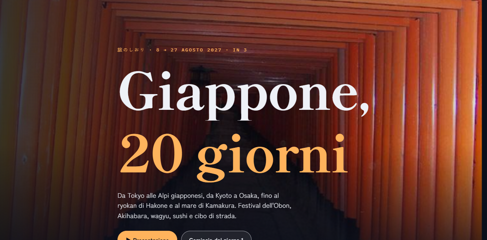

# Giappone 2027 in foto

Il programma di un viaggio di 20 giorni in Giappone (8–27 agosto 2027), giorno per giorno, con una foto per ogni cosa da vedere.

[**Apri il sito**](https://vitojgallo-dev.github.io/giappone-2027/)



## Cosa fa

- Scorrendo, la foto a tutto schermo dietro la pagina cambia a ogni giorno, e la data in alto scorre come un contatore (8, 9, 10…) con la città, i giorni di festa e una barra dei 20 giorni.
- Prima di ogni città c'è un capitolo con il nome in caratteri giapponesi (東京, 京都, 大阪…) che entra ingrandito ed esce verso l'alto.
- Ogni orario del giorno è una scheda con la sua foto: le schede salgono dal basso una dopo l'altra.
- La linea del percorso si disegna mentre scorri, fra le 8 tappe: Tokyo, Nikko, Kanazawa, Takayama, Kyoto, Osaka, Hakone, Tokyo, più una giornata ai piedi del Fuji.
- Il tasto **Presentazione** apre una slide a schermo intero per ogni giorno: frecce o barra spaziatrice sul computer, scorrimento col dito sul telefono, Esc per uscire.


## Com'è fatto

Una sola pagina statica, `index.html`, con i dati dei giorni in un array JavaScript. Le comparse e i cambi di scena usano `IntersectionObserver`, che segue sempre la posizione reale degli elementi. GSAP 3.12.5 e ScrollTrigger (da cdnjs) servono solo per gli effetti legati allo scorrimento: la linea del percorso, i capitoli, il leggero zoom delle foto. Se GSAP non si carica, la pagina resta completa e leggibile, solo senza animazioni. Con "riduci movimento" attivo nel sistema le animazioni si spengono.

Servono la rete per i caratteri (Google Fonts) e per GSAP (cdnjs). Le foto sono tutte nella cartella `foto/`.

## Aprirlo in locale

Basta aprire `index.html` nel browser, oppure servire la cartella:

```bash
npx serve .
```

## Struttura

```text
index.html     la pagina, con stile, dati e animazioni
foto/          127 foto (860 px per i giorni, 520 px per le cose da vedere)
anteprima/     le immagini di questo README
```

## Foto

Tutte le foto vengono da [Wikimedia Commons](https://commons.wikimedia.org/) con licenza libera (CC0, CC BY, CC BY-SA). Autore, licenza e link alla pagina originale di ciascuna sono elencati in fondo al sito. Le foto sono state ridimensionate e ricompresse; per il resto sono quelle originali.

Questo è un progetto personale, non collegato a nessuno dei luoghi, locali o marchi citati.
